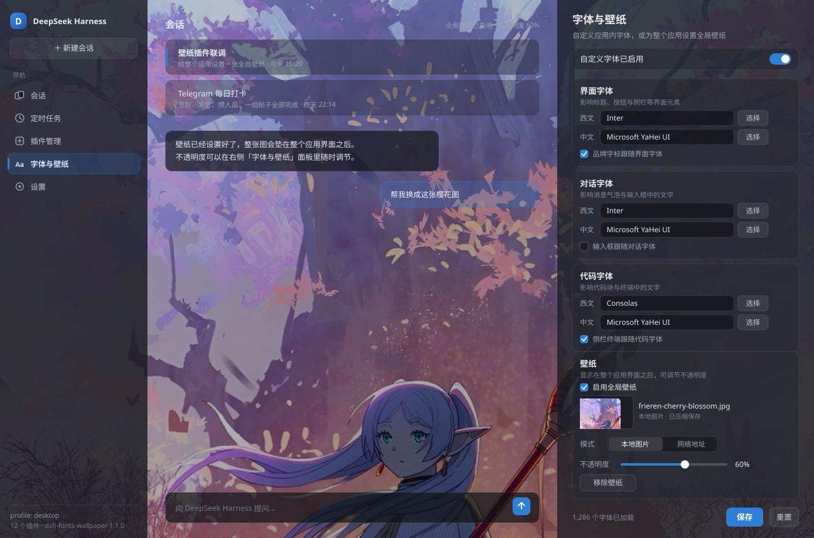
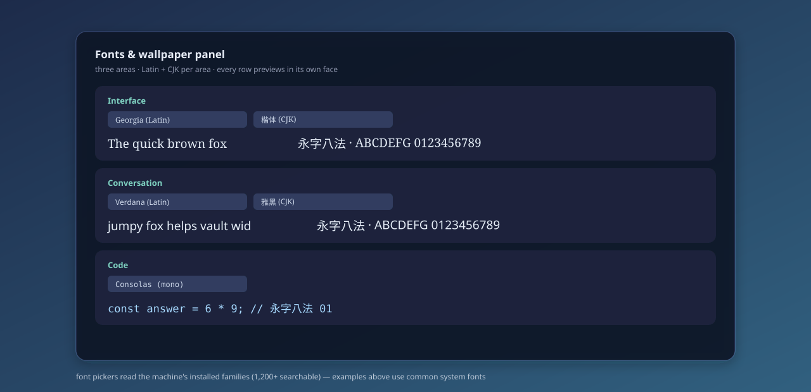
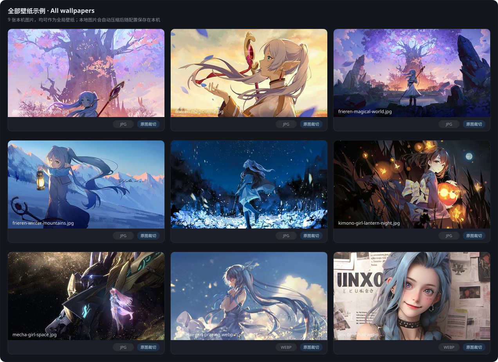

# dsh-fonts-wallpaper

**Custom fonts & a global wallpaper for DeepSeek Harness.**

One image sits behind the entire app — sidebar, conversation and preview panes all take on its colors — while interface, conversation and code fonts can each be set separately, Latin and CJK apart.



---

## ✨ Features

| | |
|---|---|
| 🖼 **Global wallpaper** | A local image or a URL, fixed behind the whole app — sidebar, conversation and preview panes included |
| 🎚 **Opacity** | A live opacity slider with a one-click enable/disable toggle |
| 🔤 **Per-area fonts** | Interface / conversation / code, each with its own Latin + CJK face and a live preview of each line |
| 📋 **Local font list** | Built from the Windows font registry and font folders — 1,200+ faces, searchable |

## 📦 Built-in presets

On a fresh machine without installed fonts or wallpapers, the panel already has options to pick:

- **Bundled font** `Dsh Builtin CJK` — a reading subset of LXGW WenKai GB Screen (all 6,768 GB2312 ideographs plus Latin and punctuation, ~1.8 MB WOFF2, SIL OFL 1.1), selectable at the top of the font picker.
- **Bundled wallpapers** — three curated wallpapers, picked straight from the wallpaper cards.

The font's `@font-face` declares `src: local("霞鹜文楷 GB 屏幕阅读版"), local("LXGW WenKai GB Screen"), url(<bundled subset>)` — **machines that have the full font keep using it**; only they don't does the bundled subset apply. The `@font-face` is injected only when the setting actually references the bundled family, so the font bytes never travel needlessly. Subset build scripts and full license texts live in `LICENSES/`.

## 🔤 Font panels

Interface, conversation and code each get one row for Latin and one for CJK, and every row shows a real preview in that face: `永字八法 ABCDEFG abcdefg 0123456789`.



## 🎨 Wallpaper gallery

Wallpapers can be any local image or URL; the whole UI stays tinted-through at any opacity:



<sub>The three preset wallpapers ship with the plugin; the figure above is an abstract illustration of how wallpapers (bundled or your own) sit behind the UI at any opacity.</sub>

## 🚀 Install

Install from npm:

```
@zhaulee/dsh-fonts-wallpaper
```

or install from this repository (source or a `npm pack` tarball attached to Releases) through **Plugin Manager → Add plugin** in DSH Desktop.

After installing, **fully quit and restart the app** (font and wallpaper strings load at startup). A **“Fonts & wallpaper”** entry appears in the left sidebar: upload a local image, paste an image URL, or drag the opacity slider.

## 🧭 Usage

- **Global wallpaper**: choose “Local image” (compressed to a ≤2000px-edge JPEG and stored with the plugin config on this machine) or “URL” (re-fetched when the page loads); “Remove wallpaper” restores the default background.
- **Fonts**: “Interface font” affects titles, buttons and the sidebar; “Conversation font” affects message bubbles and the composer; “Code font” affects code blocks and the terminal. The “Follow” checkboxes tie in the brand mark, input box and terminal.

## 🔒 Privacy

- The font list only reads local font registry keys and font folders — no network requests.
- A local wallpaper is compressed and stored on this machine together with the plugin config (the profile's `cordis.patch.yml`); a URL wallpaper stores only the URL. **Nothing is sent anywhere.**
- While enabled, the font fields in **Settings → General → Fonts** are overridden by this plugin (font sizes still apply); disabling the plugin restores the built-in font stack.

## 📄 License

[MIT](LICENSE) © 2026 ZHaoLi. Bundled font: LXGW WenKai GB Screen subset, SIL OFL 1.1 (see `LICENSES/`).
